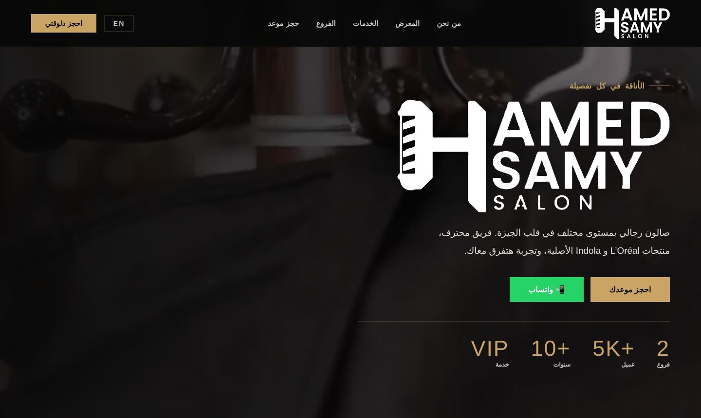
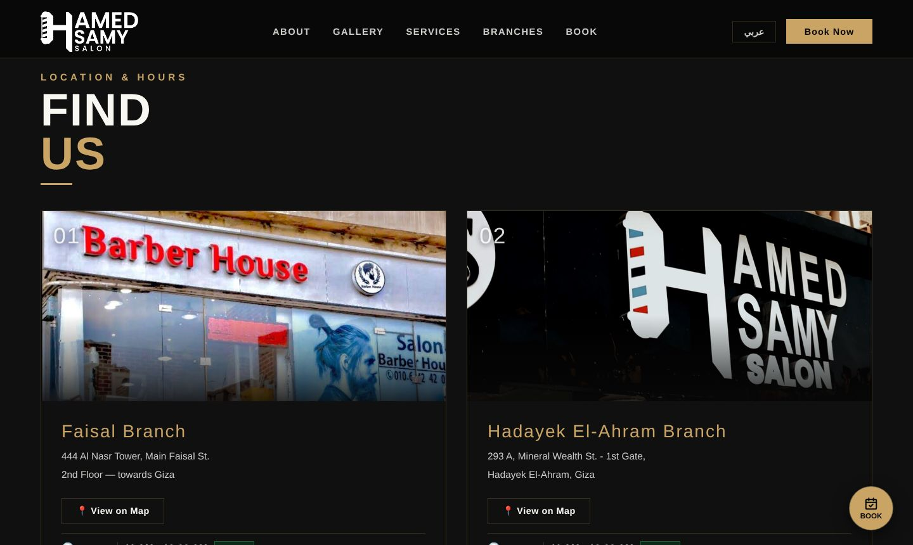
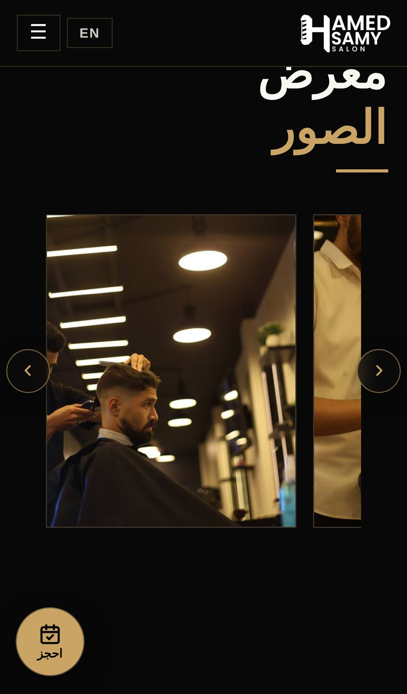

[README.md](https://github.com/user-attachments/files/34887055/README.md)
# Hamed Samy Salon

Bilingual (Egyptian Arabic / English) website for a two-branch men's barbershop in Giza, Egypt. It takes a customer from a Google search to a booked appointment on WhatsApp, with no backend and no build step.

**Live site: [hamedsamysalon.com](https://hamedsamysalon.com)**

| Desktop, Arabic (RTL) | Desktop, English (LTR) | Mobile |
| :---: | :---: | :---: |
|  |  |  |

## What it does

- **Two languages, one page.** Arabic (right to left) is the default. A toggle switches the whole page to English (left to right) instantly, with layout, text direction and spacing mirrored. Text lives in `data-ar` / `data-en` attributes and is swapped in place, so there is no reload and no duplicate markup.
- **Booking without a backend.** The booking form supports several services at once, shows a live price total, and opens WhatsApp with a prefilled message containing the name, branch, services, date and time. A quick-book modal offers the same flow from anywhere on the page.
- **Floating "Book" button.** A fixed circular button appears after the hero section, stays on screen while scrolling (important on phones), and scrolls to the booking form. It hides itself while the form is visible, sits below the nav and menu overlays, flips to the reading-direction side when the language changes, and respects `prefers-reduced-motion`.
- **Photo gallery.** A seamless infinite marquee with arrow buttons, touch swipe and a full-screen lightbox. Each arrow tap or swipe moves exactly one photo, and rapid taps stack predictably.
- **Branches.** Address, opening hours, map link and phone number for each branch.
- **Services and prices.** Service cards with VIP and groom packages, plus a reviews section.

## Engineering notes

Problems that were solved on this project and are worth a look in the code:

| Problem | Fix |
| --- | --- |
| Mixed-direction text broke in the Arabic layout: an English time range such as `11 AM - 12:30 AM` was reordered inside an RTL flex row. | The time sits in its own element with `dir="ltr"` and `unicode-bidi: isolate`, separated from the Arabic label. |
| Gallery arrows jumped two photos on phones. | The step is now computed from the real item width plus the track's computed gap (not a hard-coded value), the seamless loop is re-normalized on every tap, and taps made during a running smooth scroll build on the pending target instead of the mid-flight position. |
| Native `<select>` dropdowns showed a stray white column in Firefox on large windows. | Caused by a transformed ancestor (the scroll-reveal animation). The booking section and its form groups are excluded from transforms and filters. |
| Infinite gallery without visible resets. | The photo set is duplicated once. A `requestAnimationFrame` loop advances `scrollLeft` and subtracts one loop width when it passes the midpoint. |
| Arabic letters disconnected under wide letter-spacing. | Letter-spacing and uppercase transforms are disabled for RTL labels. |

## Tech stack

- HTML5, CSS3 (custom properties, grid, flexbox, logical properties) and vanilla JavaScript. No framework, bundler or dependencies.
- Google Fonts: Cairo (Arabic and Latin text), Bebas Neue and Anton (display).
- Booking hand-off through the WhatsApp click-to-chat link (`wa.me`).
- `IntersectionObserver` for scroll reveals and for the floating button.

## SEO and analytics

- Title, meta description and keywords in Arabic and English, canonical URL, Open Graph tags and a social preview image (`og-image.png`).
- Favicon set (`favicon.ico`, `favicon-32x32.png`, `apple-touch-icon.png`).
- Google Search Console ownership verification and Google Analytics 4. The floating button reports a `book_now_click` event.

## Deployment

Static hosting on **Vercel**. The domain was registered at **Namecheap** and points to Vercel with an `A` record for the apex domain and a `CNAME` for `www`. Vercel issues and renews the SSL certificate.

To run it locally, open `index.html` in a browser, or serve the folder:

```bash
python3 -m http.server 8000
# then visit http://localhost:8000
```

## Repository layout

```
.
├── index.html            # the whole site: markup, styles and scripts
├── og-image.png          # social sharing preview
├── favicon.ico
├── favicon-32x32.png
├── apple-touch-icon.png
└── docs/                 # screenshots used in this README
```

## Known trade-offs and next steps

- `index.html` is about 10 MB because photos, the hero video and the logo are embedded as base64. That keeps the site to one deployable file, but it slows the first load on mobile data. The next step is moving media to separate WebP and MP4 files with lazy loading.
- Bookings are requests sent over WhatsApp, so there is no availability check or calendar. A real booking backend would be the next feature if the salon wants one.

## Credits

Designed and built by [Mohamed Ibrahim](https://github.com/mohamed-m-ibrahim) for Hamed Samy Salon. The brand name, logo and photographs belong to the salon. The source is published here as a portfolio piece.
